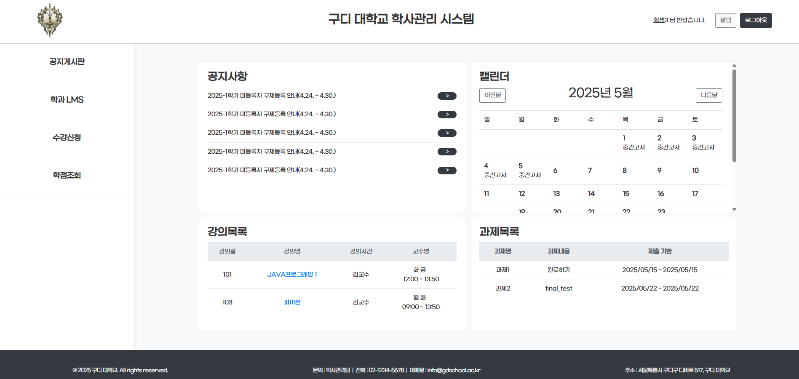
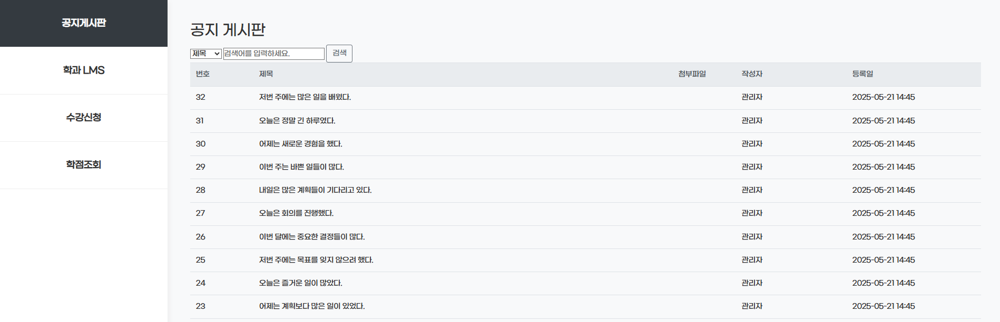
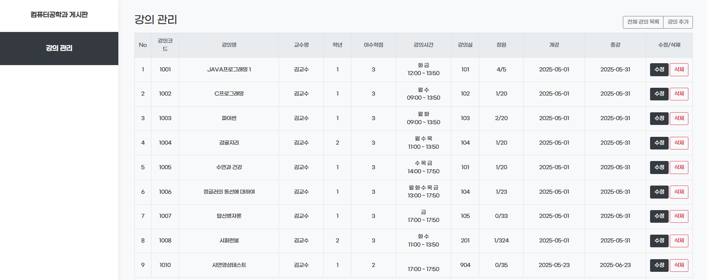
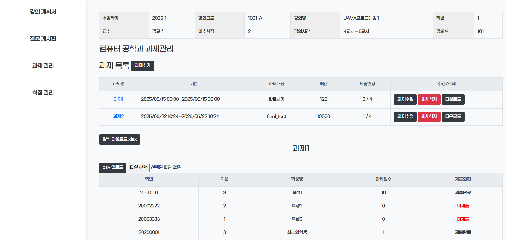

# ⭐ Learning Management System
### JSP/Servlet 기반 학사 관리 시스템

> 학생·교수·관리자가 강의, 수강, 과제 및 학사일정을 관리하는 웹 애플리케이션입니다.

JSP Model 2(MVC) 구조를 기반으로 구현한 팀 프로젝트입니다.   Servlet에서 요청을 처리하고, MyBatis로 데이터를 조회한 뒤 JSP에서 화면을 구성합니다.

 

## 주요 기능

| 구분 | 기능 |
|---|---|
| 학생 | 강의·과제 조회, 수강 신청·취소, 과제 제출, 성적 조회 |
| 교수 | 강의 개설·수정, 수강 학생 조회, 과제 및 점수 관리 |
| 관리자 | 사용자 관리, 계정 승인, 학과·강의·과목 관리 |
| 공통 | 세션 기반 로그인, 역할별 메뉴 제공, 게시판 및 알림 조회 |

 

## 내가 담당한 기능

**담당: 메인 화면, 학사일정·알림, 강의계획서 및 공통 레이아웃**

### 1. 메인 화면

로그인 사용자의 강의와 과제, 학사일정을 한 화면에서 확인할 수 있도록 구성했습니다.

- 학생의 현재 연도·학기 기준 수강 강의 조회
- 교수의 담당 강의 및 과제 목록 조회
- 수강 강의별 과제 목록 구성
- 학사일정의 시작일·종료일을 반영한 월별 달력 표시

📂 [MainLMSController.java](./src/main/java/controllers/MainLMSController.java) · [main.jsp](./src/main/webapp/views/mainLMS/main.jsp)

 

### 2. 학사일정 관리 및 알림

학사일정 등록·수정·삭제와 사용자 알림을 연결했습니다.

- 학사일정 등록·수정·삭제 및 목록 조회
- 학생·교수 역할의 알림 대상자 조회
- 일정 등록·수정 성공 시 대상자별 알림 저장
- 로그인 사용자의 개인 알림 목록 조회

| 처리 단계 | 구현 내용 |
|---|---|
| 일정 입력 | 일정명과 시작일·종료일 수신 |
| 데이터 저장 | 신규 일정 등록 또는 기존 일정 수정 |
| 알림 생성 | 학생·교수 대상 알림 데이터 저장 |
| 화면 조회 | 메인 달력과 개인 알림 목록에 표시 |

📂 [MainLMSController.java](./src/main/java/controllers/MainLMSController.java) · [UserController.java](./src/main/java/controllers/UserController.java) · [UserMapper.java](./src/main/java/models/mappers/UserMapper.java)

 

### 3. 강의계획서 조회

- 강의번호·분반·연도·학기 조건으로 강의 정보 조회
- 담당 교수 이름 조회 및 강의 화면 연동
- MyBatis Mapper에 조회 SQL을 분리하고 JSP에 결과 표시

📂 [Class1Dao.java](./src/main/java/models/classes/Class1Dao.java) · [Class1Mapper.java](./src/main/java/models/mappers/Class1Mapper.java) · [classInfo.jsp](./src/main/webapp/views/classLMS/classInfo.jsp)

 

### 4. 공통 레이아웃 및 과제 화면

- SiteMesh 기반 공통 헤더·메뉴 레이아웃 구성
- 로그인·팝업 등 공통 레이아웃 제외 경로 설정
- 요청 URI를 화면 속성으로 전달하는 Filter 구현
- 과제 목록·제출 현황·과제 제출 관련 JSP 화면 구현

📂 [SiteMeshFilter.java](./src/main/java/sitemesh/SiteMeshFilter.java) · [MainLayout.jsp](./src/main/webapp/layouts/MainLayout.jsp) · [UriFilter.java](./src/main/java/filter/UriFilter.java)

> 공통 Controller·DAO·Mapper 파일은 팀원과 함께 사용했으며, 위 내용은 해당 파일 내 담당 기능을 기준으로 정리했습니다.

 

## 기술 스택

| 구분 | 사용 기술 |
|---|---|
| Language | Java |
| Backend | Servlet, JSP Model 2(MVC) |
| 데이터 접근 | MyBatis, JDBC |
| Database | MySQL / MariaDB |
| View | JSP, JSTL, EL, HTML, CSS, JavaScript |
| 인증 | HttpSession |
| 공통 레이아웃 | SiteMesh |
| 실행 환경 | Apache Tomcat |
| 개발 도구 | Eclipse, GitHub Desktop, HeidiSQL |

 

## 요청 처리 구조

| 구성 | 역할 |
|---|---|
| Servlet Controller | 요청 파라미터 수신, 기능 처리 및 응답 화면 선택 |
| DAO | 데이터 조회·저장 요청 및 SqlSession 사용 |
| MyBatis Mapper | SQL 정의 및 데이터 매핑 |
| JSP | 요청 속성에 저장된 데이터를 JSTL·EL로 표시 |
| Filter | 인코딩 설정 및 요청 URI 가공 |
| SiteMesh | 공통 레이아웃 적용 |

별도 Service 계층 없이 Controller에서 DAO를 호출하는 구조입니다.

일반적인 조회 요청은 **브라우저 요청 → Controller → DAO → Mapper → DB 조회 → JSP 렌더링** 순서로 처리합니다.

`UriFilter`는 요청 URI에서 context path를 제거해 화면 속성으로 전달하며, 인증·권한 검사 역할과는 구분됩니다.

 

## 프로젝트 구조

| 경로 | 설명 |
|---|---|
| `src/main/java/controllers` | 기능별 Servlet Controller |
| `src/main/java/models/users` | 사용자 데이터 및 DAO |
| `src/main/java/models/classes` | 강의·수강·과제 데이터 및 DAO |
| `src/main/java/models/boards` | 게시판 데이터 및 DAO |
| `src/main/java/models/others` | 학사일정·학과·알림 데이터 및 DAO |
| `src/main/java/models/mappers` | MyBatis Mapper 및 설정 |
| `src/main/java/models/MyBatisConnection.java` | MyBatis 세션 관리 |
| `src/main/java/filter` | 요청 전처리 Filter |
| `src/main/java/sitemesh` | 공통 레이아웃 설정 |
| `src/main/webapp/layouts` | 공통 JSP 레이아웃 |
| `src/main/webapp/views` | 기능별 JSP 화면 |
| `src/main/webapp/WEB-INF` | 웹 애플리케이션 설정 및 라이브러리 |

 

## 구현하며 배운 점

- Servlet에서 요청을 받고 DAO·Mapper를 거쳐 JSP에 데이터를 전달하는 MVC 요청 흐름을 익혔습니다.
- 학사일정 저장과 사용자 알림 생성을 연결하며, 하나의 기능이 여러 데이터 처리로 이어지는 과정을 경험했습니다.
- 강의 조회 조건을 MyBatis Mapper에 정의하며 Java 코드와 SQL의 역할을 구분했습니다.
- SiteMesh로 공통 레이아웃을 구성하고, 화면별 적용·제외 경로를 관리했습니다.

 

## 화면 예시

### 메인 화면

화면 더 보기

### 공지사항

### 학과·강의 관리

### 과제·성적 관리

